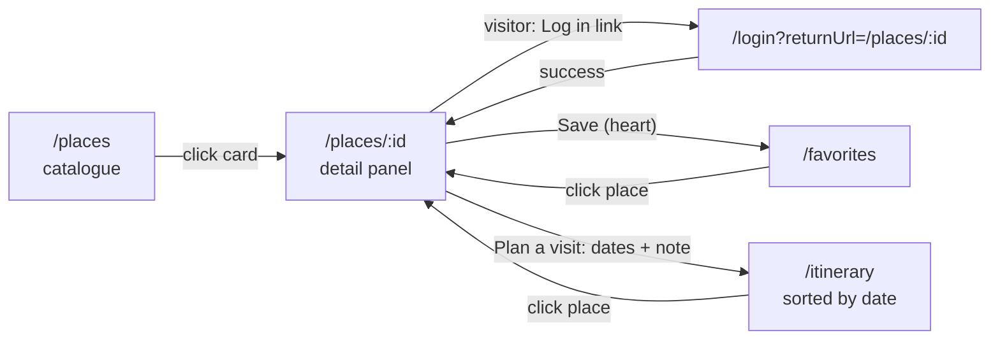
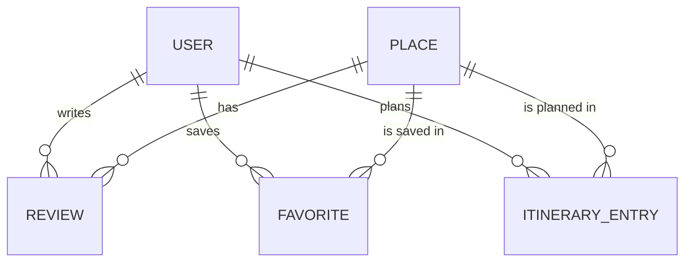

# OurTearoa — Design Document

## 1. Course Overview

**Course:** INFS803 Cloud Computing (2026, Semester 2)

**Project:** OurTearoa — a cloud-based web application for exploring New Zealand (Aotearoa).

**Brief:** Design, build and deploy a three-tier cloud application. The client, API and database must each run on managed cloud services (no locally-installed database on the server VM), the tiers must communicate only through decoupled RESTful APIs, and the whole system must be deployed publicly and kept live for the duration of the evaluation period.


**Live deployment:**

| | URL |
| :--- | :--- |
| Application | `https://ourtearoa.duckdns.org` |
| API base | `https://ourtearoa.duckdns.org/api` |
| Source repository | [OurTearoa](https://github.com/bundgaard1/OurTearoa) |

---

## 2. User Stories

These are the core requirements of the system. Every other design decision in this
document traces back to one of the stories below.

### 2.1 As a visitor

| ID | User story | Acceptance criteria |
| :--- | :--- | :--- |
| US-01 | As a visitor, I want to browse a list of New Zealand places so that I can discover destinations without an account. | `GET /places` is public; `/places` lists every place as a card without login. Done. |
| US-02 | As a visitor, I want to filter and search places by region so that I can narrow down to the part of the country I care about. | Region dropdown and name search on `/places`, backed by `?region=` (exact, case-insensitive) and `?q=` (name contains). Done. |
| US-03 | As a visitor, I want to open a place detail page showing name, region, description, photo and map coordinates so that I can decide whether to visit. | `/places/:id` shows name, region, type, description, the S3 photo when `imageUrl` is set and a Leaflet map when both coordinates are set. Done. |
| US-04 | As a visitor, I want to read reviews and ratings left by other travellers so that I can judge a place from other people's experiences. | `GET /places/:id/reviews` is public; the detail panel lists rating, comment and author name. Done. |

### 2.2 As a registered user (traveller)

| ID | User story | Acceptance criteria |
| :--- | :--- | :--- |
| US-05 | As a visitor, I want to register an account so that I can save favourites and plan an itinerary. | `POST /auth/register` with email, name (max 100) and password (min 8); `409` on a duplicate email; the user is signed in afterwards. Done. |
| US-06 | As a returning user, I want to log in so that I can access my saved data on any device. | `POST /auth/login` returns a JWT valid for 7 days; wrong credentials give `401`; data is server-side, so it is the same on any device. Done. |
| US-07 | As a registered user, I want to favourite a place so that I can build a shortlist. | Heart toggle on the detail panel and on every card; `POST /favorites`, `409` on a duplicate. Done. |
| US-08 | As a registered user, I want to view and remove my favourites so that my shortlist stays current. | `/favorites` lists saved places with remove (`DELETE /favorites/:id`). Done. |
| US-09 | As a registered user, I want to write a review and star rating for a place I have visited so that I can share my experience. | Review form with a 1-5 rating and optional comment (`POST /reviews`, `400` outside 1-5). Done. |
| US-10 | As a registered user, I want to edit or delete my own review so that I can correct it later. | Edit and delete are offered only on the user's own reviews; the API answers `404` for anyone else's. Done. |
| US-11 | As a registered user, I want to add places to an itinerary with start and end dates so that I can organise a trip. | "Plan a visit" on the detail panel with start date, end date and note; `400` if the end is before the start. Done. |
| US-12 | As a registered user, I want to view my itinerary ordered by date so that I can plan the sequence of my trip. | `/itinerary` lists entries ordered by start date (`GET /itinerary`, indexed on user and start date). Done. |
| US-13 | As a registered user, I want to edit or remove itinerary entries so that my plan can change as my trip does. | Edit and remove on `/itinerary` (`PUT`/`DELETE /itinerary/:id`, own entries only). Done. |

### 2.3 As a contributor (This is a later-stage feature.)

| ID | User story | Acceptance criteria |
| :--- | :--- | :--- |
| US-14 | As a contributor, I want to add a new place with its details and image so that the catalogue grows beyond the seed data. | API only: `POST /places` and the S3 image upload exist; no "add place" screen. Partial. |
| US-15 | As a contributor, I want to edit or remove a place I have added so that catalogue data stays accurate. | API only: `PUT`/`DELETE /places/:id` exist, but places have no owner field, so any signed-in user can change any place. Partial. |

> US-16 (contributor image upload to cloud storage) was removed as a separate story.
> Place images are covered by the S3 presigned direct upload (#71, #73, #87): any
> signed-in user can attach a photo on the place detail panel. An earlier plan to
> store images on the EC2 disk was dropped: it would put upload traffic and storage
> on the 1 GB `t3.micro`, and every image would be lost if the instance were replaced.

### 2.4 As an evaluator / operations user 

| ID | User story | Acceptance criteria |
| :--- | :--- | :--- |
| US-17 | As an evaluator, I want a documented set of RESTful endpoints that I can call directly, so that the API can be tested independently of the UI. | All endpoints listed in section 4.3; `scripts/api-smoke-test.sh` calls them without the UI (45 checks). Done. |
| US-18 | As an evaluator, I want a health endpoint that reports both the API and the database connection, so that I can confirm the whole stack is live. | `GET /api/health` runs `SELECT 1` on RDS and returns `200` with `{"status":"UP","database":"UP"}` and `latencyMs`, or `503` with a `reason`. Done. |
| US-19 | As a user on a slow or unreliable connection, I want clear loading and error states so that the interface never appears frozen. | Every data screen has loading, empty and error states, with a retry button on errors. Done. |
| US-20 | As a user, I want the app served over HTTPS on a memorable domain so that it is trustworthy and easy to reach. | `https://ourtearoa.duckdns.org` with a Let's Encrypt certificate; HTTP answers `301` to HTTPS. Done. |

### 2.5 Requirements analysis

**Problem and business context.** Visitors planning a trip around New Zealand
gather destinations, opinions and dates from many separate sources. OurTearoa
puts them in one place: browse a catalogue of places, read and write reviews,
keep a shortlist and turn it into a dated itinerary. Browsing is open to
everyone; anything personal needs an account. For the course, the same product
has to show a working three-tier cloud deployment that markers can reach and test
publicly.

**Functional requirements** (grouped from the user stories above)

| ID | Requirement | Stories |
| :--- | :--- | :--- |
| FR-1 | Public catalogue with region filter, name search and place detail (photo, map) | US-01 to US-03 |
| FR-2 | Public reviews; signed-in users create, edit and delete their own | US-04, US-09, US-10 |
| FR-3 | Account registration, login and account deletion | US-05, US-06 |
| FR-4 | Personal favourites and a dated itinerary | US-07, US-08, US-11 to US-13 |
| FR-5 | Place images stored in cloud object storage | US-03, US-14 |
| FR-6 | A documented REST API and health endpoint usable without the client | US-17, US-18 |

**Non-functional requirements**

| ID | Quality | Requirement | How it is met |
| :--- | :--- | :--- | :--- |
| NFR-1 | Availability | Reachable at a public URL from submission until marking ends | EC2 + PM2 with systemd restart, managed RDS, health endpoint (section 6.2) |
| NFR-2 | Security | HTTPS everywhere, hashed passwords, no secrets in Git, least-privilege cloud access | Let's Encrypt, bcrypt, verified TLS to RDS, IAM role for S3 (section 6.1) |
| NFR-3 | Usability | Never a blank or frozen screen | Loading, empty and error states with retry (US-19) |
| NFR-4 | Maintainability | Every merge to `main` deployed automatically and repeatably | GitHub Actions with tests, `prisma migrate deploy`, serialised runs (section 3.6) |
| NFR-5 | Cost | Stay within the student free tier or credits | Smallest instance sizes, single AZ, no load balancer or NAT (section 6.6) |
| NFR-6 | Testability | API testable independently of the UI | Section 4.3 and `scripts/api-smoke-test.sh` (45 checks) |

**Constraints**

- *Assignment brief (Option B):* three tiers; client and API decoupled by REST;
  at least 10 REST services including at least 3 `POST`; a cloud database, not a
  database installed on the VM; assets in cloud object storage; public URLs for
  client and API; Git collaboration without history rewriting. OurTearoa exposes
  25 endpoints, 8 of them `POST` (section 4.3), uses RDS and S3, and keeps a linear
  history of merged PRs.
- *Team:* two part-time students over one semester. One AWS account, administered
  by @bundgaard1, so console changes are a bottleneck (#17).
- *Budget:* free tier or student credits only, which rules out load balancers,
  Multi-AZ databases and managed container platforms.
- *Infrastructure:* the 1 GB `t3.micro` cannot build the Angular client and must not
  carry image traffic. Both shaped the design: the client is built in CI (3.6) and
  images go straight to S3 (3.4).

**Assumptions**

| Assumption | Justification | If it turns out wrong |
| :--- | :--- | :--- |
| Traffic is low: the team, markers and a few test users | Coursework, no marketing; 8 seeded places | Scale out as described in section 6.4 |
| Short outages outside marking sessions are acceptable | No SLA; availability matters during the evaluation window | Add monitoring and a second instance (6.2) |
| Users are mainly in New Zealand and Australia | Product scope | `ap-southeast-2` (Sydney) keeps latency low; a CDN would serve other regions |
| Any signed-in user may edit places and add images | Community-curated catalogue; no moderation in scope | Add an owner or admin role (US-15 is partial for this reason) |
| Stored personal data is minimal (name, email, password hash) | No payments or location tracking | Revisit data protection if more personal data is added |
| Place images may be public | They are catalogue content | Use private objects with presigned GET URLs |

**Risks**

| ID | Risk | Likelihood | Impact | Mitigation | Status |
| :--- | :--- | :--- | :--- | :--- | :--- |
| R-1 | The single EC2 instance fails or is replaced | Low | High: client and API down | Stateless API, data in RDS and S3, setup documented in `docs/`, deploy fully automated | Accepted for cost |
| R-2 | The API runs out of memory on 1 GB RAM | Medium | Medium | Swap file, client built in CI, PM2 restarts the process | Mitigated |
| R-3 | Secrets leak through Git or logs | Low | High | `.env` and keys gitignored, GitHub Actions secrets, IAM role instead of S3 keys | Audit open (#10) |
| R-4 | The database is reachable from the internet | Medium | High | Security group rules, `sslmode=verify-full`, strong password | Tightening open (#15) |
| R-5 | A broken change is deployed | Medium | Medium | Client tests run before every deploy; serialised deploys; `migrate deploy` only | Mitigated (#101, #105) |
| R-6 | Cost overrun or credits expire before marking ends | Low | High: account could be suspended | Smallest sizes, no idle extras, cost estimate in 6.6 | Budget alert recommended |
| R-7 | Data loss in the database | Low | High | RDS automated backups and point-in-time restore | Retention to be confirmed (#15) |
| R-8 | The image upload is abused | Low | Low | Login required; presigned policy limits key, type and size to 5 MB | No rate limit yet |
| R-9 | Only one team member can change AWS | Medium | Medium | Setup documented; IAM access for both members | Open (#17) |
| R-10 | A free external service fails (DuckDNS, Let's Encrypt) | Low | Medium | Certbot renews certificates; the domain could move to Route 53 | Accepted |

**Cloud opportunities used**

- *Managed database (RDS):* backups, patching and storage are AWS's job, not the team's.
- *Object storage with presigned uploads (S3):* durable image storage outside the
  VM; uploads bypass the API host completely.
- *Identity (IAM role):* the API gets short-lived S3 credentials from the instance
  role, with no access keys on disk.
- *Elastic CI capacity (GitHub Actions):* builds and tests run on hosted runners,
  so the production VM stays small.
- *Pay as you go:* the system runs on the smallest sizes now and has a clear path
  to scale (section 6.4) when needed.

**From business needs to technical objectives**

| Business need | Technical objective | Verified by |
| :--- | :--- | :--- |
| Anyone can explore places | Public, read-only endpoints; auth only for writes | Smoke test calls the public endpoints without a token |
| Travellers keep personal plans | JWT auth; ownership enforced on every user-owned row | Smoke test checks `401` without a token and `404` on other users' data |
| Trustworthy and easy to reach | HTTPS on a named domain, HTTP redirected | `curl -I http://ourtearoa.duckdns.org` returns `301` |
| Markers can assess without the UI | Every feature reachable through REST | Section 4.3, smoke test log in `docs/evidence/` |
| Rich places without overloading the VM | Images in S3 via presigned direct upload | Live `imageUrl` values point to `ourtearoa-storage` |
| Always reflects the latest code | CI/CD on every merge, tests before deploy | GitHub Actions run history |
| Stays affordable | Free-tier-sized resources | Section 6.6 estimate |

---

## 3. Architecture Design

The requirements this architecture answers are in section 2.5; its security,
availability, scalability and cost trade-offs are evaluated in section 6.

### 3.2 Tiers

**Client tier — Angular 22 SPA**

A standalone single-page application in `client/`, built on Angular standalone
components with signals for state. It is a pure client-side app: there is no
server-side rendering, so the compiled bundle in `client/dist/client/browser/` is
the entire deployable artefact. The API base URL is baked in at compile time from
`client/src/environments/` — there is no runtime configuration and no dev-server
proxy, so changing the API host means recompiling and redeploying the client.

**Application tier — Express 5 + TypeScript on Node**

A REST API in `backend/`, written in TypeScript and run directly by `tsx` with no
build step, so the deployed source and the running code are identical. Express 5
mounts every route under `/api` and delegates to controllers; `cors()` is enabled
so the client can be served from a different origin during development. Prisma
Client is the only data-access layer — no raw SQL outside the health check.

The application tier is stateless: all session state lives in the database, which is
what allows the process to be reloaded or replaced without losing data.

**Data tier — managed PostgreSQL**

AWS RDS for PostgreSQL holds all application data. Because the database is a managed
service rather than something installed on the VM, backups, patching and failover are
handled by AWS, and the application tier holds no data of its own. The connection is
TLS-verified against the AWS global CA bundle.

### 3.3 Technology stack

| Layer | Technology |
| :--- | :--- |
| Frontend | Angular 22, TypeScript, signals, Angular Router |
| Frontend tests | Vitest |
| Backend | Express 5, TypeScript, `tsx` (run from source), Node 26 |
| Data access | Prisma 7 with `@prisma/adapter-pg` |
| Database | PostgreSQL 16 on AWS RDS (`ap-southeast-2`) |
| Object storage | AWS S3 (`@aws-sdk/client-s3`) |
| Compute | AWS EC2 `t3.micro`, Amazon Linux 2023 |
| Process manager | PM2 with systemd persistence |
| Reverse proxy / TLS | Nginx, Let's Encrypt (Certbot) |
| DNS | DuckDNS |
| CI/CD | GitHub Actions → rsync + SSH deploy |
| Local development | Docker Compose (Postgres 16) |

### 3.4 Cloud services

| Service | Purpose | Notes |
| :--- | :--- | :--- |
| EC2 `t3.micro` | Hosts Nginx and the Node API | 1 GB RAM, so a swap file is configured to keep the OOM killer away from the API process |
| RDS PostgreSQL | All application data | `ap-southeast-2` (Sydney), PostgreSQL 16, TLS with `global-bundle.pem`; [instance class, storage, backup retention to be confirmed from the AWS console] |
| S3 bucket | Place images | `ourtearoa-storage` in `ap-southeast-2`; public read only on `public/*`; CORS for the frontend origin; EC2 accesses it through the IAM role `ourtearoa-ec2-s3-role` (no static keys), set up in #87; end-to-end upload working since #106, and live `imageUrl` values point to this bucket |
| DuckDNS | Public DNS for `ourtearoa.duckdns.org` | [update mechanism] |

**Access control.** The EC2 instance serves 443, and 80 only to redirect to HTTPS.
SSH on 22 is used for administration and by the deploy workflow. RDS carries its
own inbound rule for 5432 for the EC2 security group. For development,
`docs/aws-rds-setup.md` also allows individual developer `/32` addresses, which
needs the instance to be publicly accessible. Removing that access is tracked in
#15 (see section 6.1). Postgres credentials and the `DATABASE_URL` are supplied by
the process environment, never committed.

**TLS.** The RDS connection uses `sslmode=verify-full` with `global-bundle.pem`, so
the certificate is validated rather than merely encrypted.

**Image uploads (S3).** Image bytes never pass through the 1 GB EC2 instance. The
client uploads straight to S3 with a presigned POST, and the API only signs and
records:

1. `POST /api/places/:id/image-upload-url` with `{ contentType }` (JPEG, PNG or
   WebP). The API generates the object key itself,
   `public/places/<placeId>/<uuid>.<ext>`, so a client filename is never used, and
   returns `url`, `fields`, `key` and the final `imageUrl`.
2. The browser sends a multipart POST of `fields` plus the file to `url`, with no
   `Authorization` header. The signed policy only allows that exact key, that
   content type and 1 byte to 5 MB (`content-length-range`). It expires after 5 minutes.
3. `POST /api/places/:id/image` with `{ key }`. The API checks that the key belongs
   to that place and that the object exists (`HeadObject`), then saves
   `Place.imageUrl = S3_PUBLIC_BASE_URL + "/" + key`.
4. `GET /api/places` and `/api/places/:id` return `imageUrl`, and the browser loads
   the image directly from S3.

Configuration: `S3_BUCKET_NAME`, `S3_PUBLIC_BASE_URL` and `AWS_REGION`. If the
bucket settings are missing, both endpoints return `503`. If S3 itself fails, they
return `502`. Credentials come from the default AWS provider chain: the instance
role on EC2, a profile or env credentials locally.

Trade-offs: a presigned POST was chosen over a presigned PUT because S3 enforces the
size limit, not just the client. Public read on `public/*` keeps image URLs simple
and cacheable but means every uploaded image is world-readable. Replaced images
are not deleted from S3 yet. Like `PUT /places/:id`, any signed-in user may set a
place image. `HeadObject` on a missing key returns `403` instead of `404` unless the
role has `s3:ListBucket`, so the confirm step then answers `502` instead of `400`.

### 3.5 Request lifecycle

A single place-detail page load, as an example:

1. The browser loads the SPA from Nginx over HTTPS.
2. The component queries its data, which has not been populated, and issues
   `GET /api/places/:id`.
3. Nginx terminates TLS and proxies `/api/*` to `127.0.0.1:3000`.
4. Express routes the request to the places controller.
5. The controller calls Prisma, which opens a TLS connection to RDS and runs the
   query.
6. The row is serialised to JSON and returned with `200`.
7. Any error is translated to a status code and JSON error body; a failed request
   surfaces a visible error state in the component rather than a blank screen.

### 3.6 Deployment and CI/CD

Every push to `main` triggers `.github/workflows/deploy.yaml`, which:

1. Compiles the Angular production bundle on the GitHub runner. This is done in CI
   deliberately — the `t3.micro` does not have the memory to build the client.
2. Rsyncs the compiled bundle to the Nginx web root at `/var/www/ourtearoa/`.
3. SSHes into the instance, `git pull`s the backend, installs production
   dependencies, regenerates the Prisma client (`backend/generated` is not
   committed), and runs `prisma migrate deploy`. Both use `npx --no`, so the
   locked Prisma version is used and is never silently downloaded.
4. Reloads the API through PM2 and restores the SELinux `httpd_sys_content_t`
   context on the web root so Nginx can read the new files.

A `concurrency` group makes deploys run one at a time, because two overlapping
runs on the same instance delete each other's `node_modules` during `npm ci`.

Migrations run as `migrate deploy` — never `migrate dev` — so production schema
changes are applied, not regenerated. Secrets (the SSH key, host, user) are held in
GitHub Actions secrets and never appear in the repository.

Health verification after any deploy:

```bash
curl -i https://ourtearoa.duckdns.org/api/health
```

`200` with `{"status":"UP","database":"UP"}` confirms the API *and* its database
connection are live. A `503` with `reason: "timeout"` means the RDS security group
does not cover the instance; `reason: "unreachable"` means credentials or SSL
settings are wrong.

---

## 4. Interface Design

### 4.1 Screens

The frontend is deliberately minimal: plain standalone components, a single global
stylesheet with CSS variables and no UI component library. The focus of the project
is the cloud architecture, so the client only needs to exercise every API feature
with clear loading, empty and error states (US-19).

| # | Screen | Purpose | Route | Access |
| :--- | :--- | :--- | :--- | :--- |
| 1 | Place list / catalogue | Browse, search by name and filter by region | `/places` (`/` redirects here) | public |
| 2 | Place detail | Photo, description, map, favourite toggle, "Plan a visit" form, photo upload and reviews | `/places/:id` (child of `/places`) | public; actions need login |
| 3 | Login | Authenticate an existing user | `/login?returnUrl=...` | public |
| 4 | Register | Create a new account | `/register` | public |
| 5 | Favourites | The user's saved shortlist, with remove | `/favorites` | auth guard |
| 6 | Itinerary | Dated trip plan sorted by start date, with edit and remove | `/itinerary` | auth guard |
| 7 | Profile | Name, email, member since, account deletion | `/profile` | auth guard |
| 8 | Not found | Fallback for unknown URLs | `**` | public |

**Master/detail.** `/places/:id` is a child route of `/places`, so the catalogue
stays rendered and the detail panel opens beside it at half the window width. On
screens of 768 px or less the panel covers the full screen. Closing the panel
navigates back to `/places`. Because the panel is a route, a place link can be
shared or bookmarked.

The contributor stories (US-14, US-15) have no screen yet. The API endpoints exist
(section 4.3), but adding and editing places is a later-stage feature.

### 4.2 Navigation and user flows

The header is always visible. Visitors see **Places**, **Login** and **Register**;
signed-in users see **Places**, **Favourites**, **Itinerary**, their name (links to
**Profile**) and **Logout**.

**Primary flow:** browse, open a place, log in, save it as a favourite, plan a visit.



1. A visitor opens `/places`, searches by name or filters by region, and selects a
   card. The detail panel opens at `/places/:id`.
2. Reading is public. The favourite toggle, "Plan a visit", the review form and
   the photo upload are shown only to signed-in users. In place of "Plan a visit"
   and the review form, visitors see a "Log in" link that carries
   `returnUrl=/places/:id`.
3. After login the user returns to that place via `returnUrl`. Registration always
   continues to `/places`.
4. "Save" adds the place to favourites in place, without leaving the panel. The
   same toggle is on every catalogue card.
5. "Plan a visit" creates an itinerary entry with start date, end date and an
   optional note. `/itinerary` lists the entries by start date.

**Auth guard and session handling.**

- Login stores the JWT (valid 7 days) and the user in `localStorage`; an HTTP
  interceptor adds `Authorization: Bearer <token>` to requests to the API base URL
  only, so the token is never sent to S3 or other hosts.
- `/favorites`, `/itinerary` and `/profile` use `authGuard`. A visitor opening one of
  them is redirected to `/login?returnUrl=<requested URL>` and lands there after
  logging in.
- If the API answers `401` (expired or invalid token) on a protected call, the
  interceptor clears the session and redirects to `/login` with the current URL as
  `returnUrl`.
- Logout and account deletion clear the session and return to `/places`.


### 4.3 API endpoints

All endpoints are under `/api` and speak JSON. Responses are `200`/`201` on success
and a JSON `{ "error": "..." }` body on failure.

Base URL: `https://ourtearoa.duckdns.org/api` (local: `http://localhost:3000/api`).
"Auth" means an `Authorization: Bearer <JWT>` header from `POST /auth/login` or
`POST /auth/register`. Another user's resource returns `404`, not `403`.

| Method | Path | Auth | Success | Notes |
|---|---|---|---|---|
| GET | `/health` | no | 200 | API and database status |
| POST | `/auth/register` | no | 201 | `email`, `name`, `password` (min 8); 409 if email exists |
| POST | `/auth/login` | no | 200 | returns `token` and `user`; 401 on bad credentials |
| GET | `/users/me` | yes | 200 | own profile including email |
| GET | `/users/:id` | yes | 200 | `id`, `name`, `createdAt` only |
| DELETE | `/users/me` | yes | 204 | deletes own account and, via cascade, its reviews, favorites and itinerary |
| GET | `/favorites` | yes | 200 | own favorites with place |
| POST | `/favorites` | yes | 201 | `placeId`; 409 if already a favorite |
| DELETE | `/favorites/:id` | yes | 204 | own favorites only |
| GET | `/itinerary` | yes | 200 | own entries ordered by start date |
| POST | `/itinerary` | yes | 201 | `placeId`, `startDate`, `endDate`, `note?`; 400 if end before start |
| PUT | `/itinerary/:id` | yes | 200 | partial update |
| DELETE | `/itinerary/:id` | yes | 204 | own entries only |
| GET | `/places/:id/reviews` | no | 200 | reviews with author name |
| GET | `/reviews/:id` | no | 200 | |
| POST | `/reviews` | yes | 201 | `placeId`, `rating` (1-5), `comment?` |
| PUT | `/reviews/:id` | yes | 200 | own reviews only |
| DELETE | `/reviews/:id` | yes | 204 | own reviews only |
| GET | `/places` | no | 200 | optional `region` (exact, case-insensitive) and `q` (name contains, case-insensitive); sorted by name |
| GET | `/places/:id` | no | 200 | 404 if unknown |
| POST | `/places` | yes | 201 | `name` (max 200), `region` (max 100), `description?`, `latitude?` (-90..90), `longitude?` (-180..180), `type?` |
| PUT | `/places/:id` | yes | 200 | partial update with the same validation |
| DELETE | `/places/:id` | yes | 204 | cascades to its reviews, favourites and itinerary entries |
| POST | `/places/:id/image-upload-url` | yes | 201 | `contentType` (jpeg/png/webp); presigned S3 POST, `key`, `imageUrl`; 503 if S3 is not configured |
| POST | `/places/:id/image` | yes | 200 | `key` from the upload step; checks the object exists and saves `imageUrl` |

`scripts/api-smoke-test.sh [BASE_URL]` calls these endpoints and checks the status
codes, so they can be exercised without the client.

---

## 5. Data Design

The schema lives in `backend/prisma/schema.prisma` and is applied with Prisma
migrations (`backend/prisma/migrations/`): `migrate dev` locally, `migrate deploy`
in the deployment workflow. All primary keys are UUID strings generated by Prisma.
Model fields are camelCase; tables and columns are snake_case via `@@map`/`@map`
(for example `Place.imageUrl` is the column `places.image_url`).



### 5.1 Place (`places`)

| Field | Type | Notes |
| :--- | :--- | :--- |
| `id` | String (UUID) | primary key |
| `name` | VarChar(200) | required |
| `region` | VarChar(100) | required; used by the region filter |
| `description` | String? | |
| `latitude` | Float? | -90..90; the map is shown only when both coordinates are set |
| `longitude` | Float? | -180..180 |
| `type` | String? | free text, for example "Fjord" or "National Park" |
| `imageUrl` | String? | full public S3 URL under `public/places/<id>/`, set by `POST /places/:id/image` |
| `createdAt`, `updatedAt` | DateTime | set automatically |

### 5.2 User (`users`)

| Field | Type | Notes |
| :--- | :--- | :--- |
| `id` | String (UUID) | primary key; the JWT `sub` |
| `email` | String | unique |
| `password` | String | bcrypt hash, never returned by the API |
| `name` | VarChar(100) | shown on reviews |
| `createdAt`, `updatedAt` | DateTime | `createdAt` is shown as "Member since" |

### 5.3 Review (`reviews`)

| Field | Type | Notes |
| :--- | :--- | :--- |
| `id` | String (UUID) | primary key |
| `placeId` | String | FK to `places.id`, cascade delete, indexed |
| `userId` | String | FK to `users.id`, cascade delete |
| `rating` | SmallInt | 1..5, validated by the API |
| `comment` | String? | |
| `createdAt`, `updatedAt` | DateTime | |

### 5.4 Favorite (`favorites`)

| Field | Type | Notes |
| :--- | :--- | :--- |
| `id` | String (UUID) | primary key |
| `placeId` | String | FK to `places.id`, cascade delete, indexed |
| `userId` | String | FK to `users.id`, cascade delete |
| `createdAt` | DateTime | |

Unique on (`userId`, `placeId`), so a place can be saved only once per user (`409`
on a duplicate).

### 5.5 ItineraryEntry (`itinerary_entries`)

| Field | Type | Notes |
| :--- | :--- | :--- |
| `id` | String (UUID) | primary key |
| `placeId` | String | FK to `places.id`, cascade delete |
| `userId` | String | FK to `users.id`, cascade delete |
| `startDate` | DateTime | |
| `endDate` | DateTime | must not be before `startDate` (`400`) |
| `note` | String? | |
| `createdAt`, `updatedAt` | DateTime | |

Indexed on (`userId`, `startDate`), matching `GET /itinerary`, which returns the
user's entries ordered by start date.

### 5.6 Design notes

- **Cascades.** Deleting a user (`DELETE /users/me`) removes their reviews,
  favourites and itinerary entries; deleting a place removes everything that
  references it. No orphan rows are possible.
- **Ownership.** Every user-owned row carries `userId`, and the API filters by the
  token's user. Another user's row answers `404`, not `403`, so IDs cannot be
  probed.
- **Images outside the database.** Only the URL is stored; the bytes are in S3
  (section 3.4). Replaced images are not yet deleted from the bucket.
- **Seed data.** `backend/prisma/seed.ts` loads the demo places, a demo user (with a
  hashed password) and sample reviews, favourites and an itinerary entry.

---

## 6. Cloud Engineering Quality

This section evaluates the deployed system against the quality attributes in
section 2.5 and states the trade-offs made. Values in square brackets still need
to be confirmed from the AWS console (#15, #17).

### 6.1 Security

| Layer | Current controls | Known gaps and next steps |
| :--- | :--- | :--- |
| Network | EC2 security group opens 443, 80 (redirect only) and 22; RDS allows 5432 from the EC2 security group | Developer `/32` rules require RDS "Publicly accessible = Yes"; remove them and use an SSH tunnel or bastion (#15). SSH could be limited to known addresses or replaced by SSM Session Manager |
| Data in transit | HTTPS with Let's Encrypt, HTTP redirected with `301`; RDS over TLS with `sslmode=verify-full`; S3 over HTTPS | Add HSTS in Nginx |
| Data at rest | Passwords stored as bcrypt hashes (cost 10); images in S3 | [RDS storage encryption to be confirmed]; S3 encrypts new objects by default (SSE-S3) |
| Identity and access | EC2 uses the IAM role `ourtearoa-ec2-s3-role` for S3, so no access keys exist on the server; presigned POST limits key, type, size and lifetime | Scope the role to the bucket and the needed actions only; give each team member their own IAM user with MFA (#17) |
| Application | JWT (7 days) for every write; ownership checked on every user-owned row (`404` for others); input validated in controllers; Prisma parameterises all queries | CORS is open to any origin; no rate limiting on login or upload; no security headers (helmet); the token is in `localStorage`, which is exposed to XSS. Any signed-in user may edit places (US-15 partial) |
| Secrets | `.env` and keys are gitignored; deploy credentials are GitHub Actions secrets; only `.env.example` and the public RDS CA bundle are committed | Repository and history audit open (#10); AWS Secrets Manager or SSM Parameter Store would replace the `.env` on the instance |
| Operating system | Amazon Linux 2023 with SELinux enforcing; Nginx is the only public process, the API listens on `127.0.0.1:3000` | Regular `dnf upgrade` is manual |

Trade-off: the controls above cover the risks of a small public catalogue with
minimal personal data. Rate limiting, a WAF and a private-subnet database were left
out to stay within time and the free tier, and are listed in 6.7.

### 6.2 Availability and reliability

**Current design.** A single EC2 instance in one Availability Zone serves the client
and the API. Reliability comes from restarting rather than redundancy:

- PM2 restarts the API if it crashes, and its systemd unit starts PM2 again after a
  reboot. Nginx is a systemd service as well.
- The swap file protects the API from the OOM killer on 1 GB RAM (R-2).
- RDS is a managed service; AWS replaces failed hardware and applies patches in the
  maintenance window. [Single-AZ or Multi-AZ to be confirmed; Single-AZ assumed.]
- `GET /api/health` checks the database with a timeout (`HEALTH_DB_TIMEOUT_MS`,
  default 3000 ms) and returns `503` with a `reason`, so a failure can be told apart
  from a network or credential problem (section 3.6).
- Deploys are serialised and tests run first (R-5). PM2 restarts the process, so a
  deploy causes a downtime of a few seconds.

**Expected availability (estimate).** The instance, its AZ and the database are each
single points of failure. AWS offers 99.5% for a single EC2 instance and 99.5% for a
Single-AZ RDS instance; together that is roughly 99% per month, or up to about 7
hours of possible downtime. That is acceptable under the assumption in 2.5 that short
outages outside marking sessions do not matter.

**Path to high availability.**

1. CloudWatch alarm or an external uptime check on `/api/health`, and EC2
   auto-recovery on a failed status check. Low cost, first step.
2. An Application Load Balancer and an Auto Scaling Group across two AZs, with an
   AMI or launch template replacing the manual setup. This requires moving TLS from
   Certbot to ACM on the load balancer and the domain to Route 53.
3. RDS Multi-AZ for automatic database failover (typically one to two minutes).

### 6.3 Backup and disaster recovery

| Component | Where the state lives | Backup | Recovery |
| :--- | :--- | :--- | :--- |
| Application data | RDS | Automated daily snapshots and point-in-time restore [retention to be confirmed]; manual snapshot before risky migrations | Restore to a new instance and update `DATABASE_URL` |
| Schema | Git (`backend/prisma/migrations/`) | Every migration is versioned | `prisma migrate deploy` |
| Images | S3 | 99.999999999% designed durability, stored across several AZs | Versioning [not enabled]; enabling it would protect against accidental deletes and overwrites |
| Code and client | GitHub | Every merged PR | The deploy workflow rebuilds and redeploys |
| EC2 instance | None (stateless) | Setup documented in `docs/cloud-ec2-setup.md` | Launch a new instance, follow the guide, update the GitHub secrets and DuckDNS |

**Targets (estimates, not tested).** RPO: about 5 minutes for the database, the
interval of RDS transaction log backups; zero for code. RTO: about 1 hour to rebuild
the EC2 instance by hand and 30 to 60 minutes for an RDS point-in-time restore.
Everything runs in `ap-southeast-2`, so a region-wide outage is not covered;
cross-region snapshot copies and S3 replication would be the next step if that
mattered. A restore has not been rehearsed yet.

Risk: `backend/prisma/seed.ts` deletes all rows before seeding and must never be run
against RDS.

### 6.4 Scalability and elasticity

**What scales well already.**

- The API is stateless: sessions are JWTs, not server memory, so more instances can
  be added behind a load balancer without sticky sessions.
- Image bytes go straight between the browser and S3, which scales on its own; the
  API only signs and records.
- The client is static files, ready to move to S3 and CloudFront.
- GitHub Actions provides build capacity on demand, so the production instance does
  not need to be sized for builds.

**Current limits.** One `t3.micro` (2 vCPU burstable, 1 GB RAM) with no automatic
scaling. Burstable CPU credits can run out under sustained load. Scaling today means
manual vertical scaling: stop the instance and change the instance type, with
downtime. RDS can be resized the same way.

**Scale-out path.**

| Load grows in | Response |
| :--- | :--- |
| Static client and images | CloudFront in front of S3 and the SPA; caches at the edge and removes static traffic from the EC2 instance |
| API requests | ALB and Auto Scaling Group with a target-tracking policy on CPU or request count |
| Database connections | Limit the Prisma pool per instance, or add RDS Proxy |
| Database reads | Larger instance class, then a read replica for the public catalogue |

Trade-off: elasticity was not built because the expected load (2.5 assumptions) does
not need it and an ALB alone would cost more than the rest of the system together
(6.6). The stateless design keeps the option open.

### 6.5 Performance

- **Region.** Everything runs in `ap-southeast-2` (Sydney), close to the expected
  users in New Zealand and Australia, and the API and database are in the same
  region.
- **Queries.** Region filter and name search are done in the database (`mode:
  insensitive`), not in the client. Foreign keys used for lookups are indexed
  (`placeId` on reviews and favourites), and itineraries use the composite index
  (`userId`, `startDate`) that matches their sort order (section 5).
- **Images.** Loaded directly from S3, not through Nginx or Node; the 5 MB limit
  keeps uploads bounded.
- **Client.** Production build from CI, served as static files by Nginx; the client
  loads data on demand per page.
- **Observability.** The health endpoint reports `latencyMs` for the database check.

Not yet done: no CDN or HTTP caching headers, no pagination on `GET /places` (fine
for the current catalogue size), no load test. Name search with `contains` cannot
use a normal index; a trigram index would be needed for a large catalogue.

### 6.6 Cost optimisation

**Monthly estimate** (on-demand prices for `ap-southeast-2`, 730 hours, taken from
public AWS price lists in October 2026; estimates, not billing data):

| Item | Estimate (USD/month) | Note |
| :--- | :--- | :--- |
| EC2 `t3.micro` | about 9.93 | $0.0136 per hour |
| EBS root volume | about 1 | Small gp3 volume; [size to be confirmed] |
| RDS PostgreSQL | about 11.68 | If `db.t4g.micro` Single-AZ at $0.016 per hour; [class to be confirmed]; storage extra, backup storage up to the database size free |
| Public IPv4 address | about 3.65 | $0.005 per hour for public IPv4 addresses |
| S3 | under 0.10 | A few MB of images and low request volume |
| Data transfer | close to 0 | Low traffic |
| DuckDNS, Let's Encrypt | 0 | Free services |
| GitHub Actions | 0 | Free for public repositories |
| **Total** | **about 26** | Before free tier or credits |

Whether this is covered depends on the account type [to be confirmed]: accounts
created before 15 July 2025 have the 12-month free tier (750 hours of a micro
instance for EC2 and for RDS), while newer accounts get credits of up to $200 and,
on the free plan, are closed when the credits run out or after six months (R-6).

**Decisions taken for cost.**

- Smallest instance sizes; the client build moved to CI so the instance can stay at
  1 GB.
- No ALB, NAT gateway, Multi-AZ database or CloudFront; each would add a fixed
  monthly cost larger than the current need.
- Images in S3 rather than larger EBS volumes or database rows.
- Free DNS and certificates.

**Recommended.** An AWS Budgets alert at a small threshold (for example $10), deleting
replaced images or adding an S3 lifecycle rule, and stopping or deleting all
resources after marking ends.

### 6.7 Trade-off summary and future improvements

| Decision | Benefit | Cost or risk accepted |
| :--- | :--- | :--- |
| Single EC2 instance, no load balancer | Cheapest, simple to operate | Single point of failure, no automatic scaling (6.2, 6.4) |
| Managed RDS instead of Postgres on the VM | Backups, patching, required by the brief | Higher cost than self-hosting |
| Public RDS endpoint for development | Developers can run migrations and inspect data directly | Larger attack surface until #15 is done |
| Client built in CI | Production VM stays small | Deploy depends on GitHub Actions |
| Presigned POST direct to S3 | No image traffic on the VM, size enforced by S3 | Images are public; replaced files stay in the bucket |
| JWT in `localStorage` | Simple, stateless, works across tabs | Exposed to XSS; no server-side logout |
| Let's Encrypt and DuckDNS | Free HTTPS on a named domain | Depends on free external services (R-10) |
| PM2 restart on deploy | Simple and reliable | A few seconds of downtime per deploy |

**Future improvements, in priority order.**

1. Close #15 and #17: private RDS access, least-privilege IAM users with MFA.
2. Monitoring: CloudWatch alarms on the health endpoint, CPU and RDS storage, plus
   an AWS Budgets alert.
3. Application hardening: restricted CORS origin, helmet, rate limiting on login and
   upload, HSTS.
4. Run the tests on every pull request, not only before deploy.
5. S3 versioning and deleting replaced images; a rehearsed RDS restore.
6. CloudFront for the client and images.
7. ALB with an Auto Scaling Group across two AZs and RDS Multi-AZ, when traffic or
   availability needs justify the cost.
