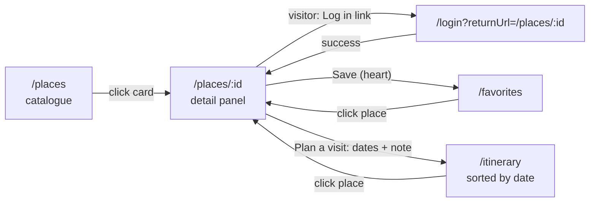
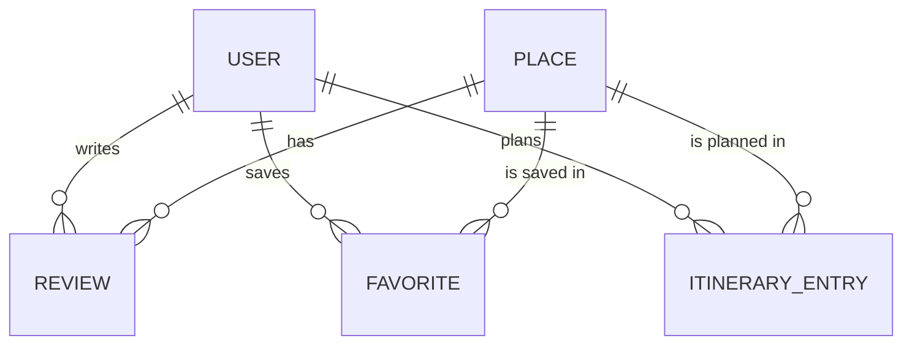

# OurTearoa — Design Document

## 1. Course Overview

**Course:** INFS803 Cloud Computing (2026, Semester 2)

**Project:** OurTearoa — a cloud-based web application for exploring New Zealand (Aotearoa).

**Brief:** Design, build and deploy a three-tier cloud application. The client, API and database must each run on managed cloud services (no locally-installed database on the server VM), the tiers must communicate only through decoupled RESTful APIs, and the whole system must be deployed publicly and kept live for the duration of the evaluation period.


**Live deployment:**

| | URL |
| :--- | :--- |
| Application | `https://ourtearoa.duckdns.org` |
| API base | `https://ourtearoa.duckdns.org/api` |
| Source repository | [OurTearoa](https://github.com/bundgaard1/OurTearoa) |

---

## 2. User Stories

These are the core requirements of the system. Every other design decision in this
document traces back to one of the stories below.

### 2.1 As a visitor

| ID | User story | Acceptance criteria |
| :--- | :--- | :--- |
| US-01 | As a visitor, I want to browse a list of New Zealand places so that I can discover destinations without an account. | [ ] |
| US-02 | As a visitor, I want to filter and search places by region so that I can narrow down to the part of the country I care about. | [ ] |
| US-03 | As a visitor, I want to open a place detail page showing name, region, description, photo and map coordinates so that I can decide whether to visit. | [ ] |
| US-04 | As a visitor, I want to read reviews and ratings left by other travellers so that I can judge a place from other people's experiences. | [ ] |

### 2.2 As a registered user (traveller)

| ID | User story | Acceptance criteria |
| :--- | :--- | :--- |
| US-05 | As a visitor, I want to register an account so that I can save favourites and plan an itinerary. | [ ] |
| US-06 | As a returning user, I want to log in so that I can access my saved data on any device. | [ ] |
| US-07 | As a registered user, I want to favourite a place so that I can build a shortlist. | [ ] |
| US-08 | As a registered user, I want to view and remove my favourites so that my shortlist stays current. | [ ] |
| US-09 | As a registered user, I want to write a review and star rating for a place I have visited so that I can share my experience. | [ ] |
| US-10 | As a registered user, I want to edit or delete my own review so that I can correct it later. | [ ] |
| US-11 | As a registered user, I want to add places to an itinerary with start and end dates so that I can organise a trip. | [ ] |
| US-12 | As a registered user, I want to view my itinerary ordered by date so that I can plan the sequence of my trip. | [ ] |
| US-13 | As a registered user, I want to edit or remove itinerary entries so that my plan can change as my trip does. | [ ] |

### 2.3 As a contributor (This is a later-stage feature.)

| ID | User story | Acceptance criteria |
| :--- | :--- | :--- |
| US-14 | As a contributor, I want to add a new place with its details and image so that the catalogue grows beyond the seed data. | [ ] |
| US-15 | As a contributor, I want to edit or remove a place I have added so that catalogue data stays accurate. | [ ] |

> US-16 (contributor image upload to cloud storage) was removed as a separate story.
> Place images are covered by the S3 presigned direct upload (#71, #73, #87): any
> signed-in user can attach a photo on the place detail panel. An earlier plan to
> store images on the EC2 disk was dropped: it would put upload traffic and storage
> on the 1 GB `t3.micro`, and every image would be lost if the instance were replaced.

### 2.4 As an evaluator / operations user 

| ID | User story | Acceptance criteria |
| :--- | :--- | :--- |
| US-17 | As an evaluator, I want a documented set of RESTful endpoints that I can call directly, so that the API can be tested independently of the UI. | [ ] |
| US-18 | As an evaluator, I want a health endpoint that reports both the API and the database connection, so that I can confirm the whole stack is live. | [ ] |
| US-19 | As a user on a slow or unreliable connection, I want clear loading and error states so that the interface never appears frozen. | [ ] |
| US-20 | As a user, I want the app served over HTTPS on a memorable domain so that it is trustworthy and easy to reach. | [ ] |

---

## 3. Architecture Design

### 3.2 Tiers

**Client tier — Angular 22 SPA**

A standalone single-page application in `client/`, built on Angular standalone
components with signals for state. It is a pure client-side app: there is no
server-side rendering, so the compiled bundle in `client/dist/client/browser/` is
the entire deployable artefact. The API base URL is baked in at compile time from
`client/src/environments/` — there is no runtime configuration and no dev-server
proxy, so changing the API host means recompiling and redeploying the client.

**Application tier — Express 5 + TypeScript on Node**

A REST API in `backend/`, written in TypeScript and run directly by `tsx` with no
build step, so the deployed source and the running code are identical. Express 5
mounts every route under `/api` and delegates to controllers; `cors()` is enabled
so the client can be served from a different origin during development. Prisma
Client is the only data-access layer — no raw SQL outside the health check.

The application tier is stateless: all session state lives in the database, which is
what allows the process to be reloaded or replaced without losing data.

**Data tier — managed PostgreSQL**

AWS RDS for PostgreSQL holds all application data. Because the database is a managed
service rather than something installed on the VM, backups, patching and failover are
handled by AWS, and the application tier holds no data of its own. The connection is
TLS-verified against the AWS global CA bundle.

### 3.3 Technology stack

| Layer | Technology |
| :--- | :--- |
| Frontend | Angular 22, TypeScript, signals, Angular Router |
| Frontend tests | Vitest |
| Backend | Express 5, TypeScript, `tsx` (run from source), Node 26 |
| Data access | Prisma 7 with `@prisma/adapter-pg` |
| Database | PostgreSQL 16 on AWS RDS (`ap-southeast-2`) |
| Object storage | AWS S3 (`@aws-sdk/client-s3`) |
| Compute | AWS EC2 `t3.micro`, Amazon Linux 2023 |
| Process manager | PM2 with systemd persistence |
| Reverse proxy / TLS | Nginx, Let's Encrypt (Certbot) |
| DNS | DuckDNS |
| CI/CD | GitHub Actions → rsync + SSH deploy |
| Local development | Docker Compose (Postgres 16) |

### 3.4 Cloud services

| Service | Purpose | Notes |
| :--- | :--- | :--- |
| EC2 `t3.micro` | Hosts Nginx and the Node API | 1 GB RAM, so a swap file is configured to keep the OOM killer away from the API process |
| RDS PostgreSQL | All application data | `ap-southeast-2` (Sydney), PostgreSQL 16, TLS with `global-bundle.pem`; [instance class, storage, backup retention to be confirmed from the AWS console] |
| S3 bucket | Place images | `ourtearoa-storage` in `ap-southeast-2`; public read only on `public/*`; CORS for the frontend origin; EC2 accesses it through the IAM role `ourtearoa-ec2-s3-role` (no static keys), set up in #87; end-to-end upload still under investigation in #106 |
| DuckDNS | Public DNS for `ourtearoa.duckdns.org` | [update mechanism] |

**Access control.** The EC2 instance is reachable only on 443 (and 22 for SSH from
the team's addresses). The database is not public: RDS carries its own inbound rule
for 5432 scoped to the EC2 security group, so only the API host can open a
connection. Postgres credentials and the `DATABASE_URL` are supplied by the process
environment, never committed.

**TLS.** The RDS connection uses `sslmode=verify-full` with `global-bundle.pem`, so
the certificate is validated rather than merely encrypted.

**Image uploads (S3).** Image bytes never pass through the 1 GB EC2 instance. The
client uploads straight to S3 with a presigned POST, and the API only signs and
records:

1. `POST /api/places/:id/image-upload-url` with `{ contentType }` (JPEG, PNG or
   WebP). The API generates the object key itself,
   `public/places/<placeId>/<uuid>.<ext>`, so a client filename is never used, and
   returns `url`, `fields`, `key` and the final `imageUrl`.
2. The browser sends a multipart POST of `fields` plus the file to `url`, with no
   `Authorization` header. The signed policy only allows that exact key, that
   content type and 1 byte to 5 MB (`content-length-range`). It expires after 5 minutes.
3. `POST /api/places/:id/image` with `{ key }`. The API checks that the key belongs
   to that place and that the object exists (`HeadObject`), then saves
   `Place.imageUrl = S3_PUBLIC_BASE_URL + "/" + key`.
4. `GET /api/places` and `/api/places/:id` return `imageUrl`, and the browser loads
   the image directly from S3.

Configuration: `S3_BUCKET_NAME`, `S3_PUBLIC_BASE_URL` and `AWS_REGION`. If the
bucket settings are missing, both endpoints return `503`. If S3 itself fails, they
return `502`. Credentials come from the default AWS provider chain: the instance
role on EC2, a profile or env credentials locally.

Trade-offs: a presigned POST was chosen over a presigned PUT because S3 enforces the
size limit, not just the client. Public read on `public/*` keeps image URLs simple
and cacheable but means every uploaded image is world-readable. Replaced images
are not deleted from S3 yet. Like `PUT /places/:id`, any signed-in user may set a
place image. `HeadObject` on a missing key returns `403` instead of `404` unless the
role has `s3:ListBucket`, so the confirm step then answers `502` instead of `400`.

### 3.5 Request lifecycle

A single place-detail page load, as an example:

1. The browser loads the SPA from Nginx over HTTPS.
2. The component queries its data, which has not been populated, and issues
   `GET /api/places/:id`.
3. Nginx terminates TLS and proxies `/api/*` to `127.0.0.1:3000`.
4. Express routes the request to the places controller.
5. The controller calls Prisma, which opens a TLS connection to RDS and runs the
   query.
6. The row is serialised to JSON and returned with `200`.
7. Any error is translated to a status code and JSON error body; a failed request
   surfaces a visible error state in the component rather than a blank screen.

### 3.6 Deployment and CI/CD

Every push to `main` triggers `.github/workflows/deploy.yaml`, which:

1. Compiles the Angular production bundle on the GitHub runner. This is done in CI
   deliberately — the `t3.micro` does not have the memory to build the client.
2. Rsyncs the compiled bundle to the Nginx web root at `/var/www/ourtearoa/`.
3. SSHes into the instance, `git pull`s the backend, installs production
   dependencies, regenerates the Prisma client (`backend/generated` is not
   committed), and runs `prisma migrate deploy`. Both use `npx --no`, so the
   locked Prisma version is used and is never silently downloaded.
4. Reloads the API through PM2 and restores the SELinux `httpd_sys_content_t`
   context on the web root so Nginx can read the new files.

A `concurrency` group makes deploys run one at a time, because two overlapping
runs on the same instance delete each other's `node_modules` during `npm ci`.

Migrations run as `migrate deploy` — never `migrate dev` — so production schema
changes are applied, not regenerated. Secrets (the SSH key, host, user) are held in
GitHub Actions secrets and never appear in the repository.

Health verification after any deploy:

```bash
curl -i https://ourtearoa.duckdns.org/api/health
```

`200` with `{"status":"UP","database":"UP"}` confirms the API *and* its database
connection are live. A `503` with `reason: "timeout"` means the RDS security group
does not cover the instance; `reason: "unreachable"` means credentials or SSL
settings are wrong.

---

## 4. Interface Design

### 4.1 Screens

The frontend is deliberately minimal: plain standalone components, a single global
stylesheet with CSS variables and no UI component library. The focus of the project
is the cloud architecture, so the client only needs to exercise every API feature
with clear loading, empty and error states (US-19).

| # | Screen | Purpose | Route | Access |
| :--- | :--- | :--- | :--- | :--- |
| 1 | Place list / catalogue | Browse, search by name and filter by region | `/places` (`/` redirects here) | public |
| 2 | Place detail | Photo, description, map, favourite toggle, "Plan a visit" form, photo upload and reviews | `/places/:id` (child of `/places`) | public; actions need login |
| 3 | Login | Authenticate an existing user | `/login?returnUrl=...` | public |
| 4 | Register | Create a new account | `/register` | public |
| 5 | Favourites | The user's saved shortlist, with remove | `/favorites` | auth guard |
| 6 | Itinerary | Dated trip plan sorted by start date, with edit and remove | `/itinerary` | auth guard |
| 7 | Profile | Name, email, member since, account deletion | `/profile` | auth guard |
| 8 | Not found | Fallback for unknown URLs | `**` | public |

**Master/detail.** `/places/:id` is a child route of `/places`, so the catalogue
stays rendered and the detail panel opens beside it at half the window width. On
screens of 768 px or less the panel covers the full screen. Closing the panel
navigates back to `/places`. Because the panel is a route, a place link can be
shared or bookmarked.

The contributor stories (US-14, US-15) have no screen yet. The API endpoints exist
(section 4.3), but adding and editing places is a later-stage feature.

### 4.2 Navigation and user flows

The header is always visible. Visitors see **Places**, **Login** and **Register**;
signed-in users see **Places**, **Favourites**, **Itinerary**, their name (links to
**Profile**) and **Logout**.

**Primary flow:** browse, open a place, log in, save it as a favourite, plan a visit.



1. A visitor opens `/places`, searches by name or filters by region, and selects a
   card. The detail panel opens at `/places/:id`.
2. Reading is public. The favourite toggle, "Plan a visit", the review form and
   the photo upload are shown only to signed-in users. In place of "Plan a visit"
   and the review form, visitors see a "Log in" link that carries
   `returnUrl=/places/:id`.
3. After login the user returns to that place via `returnUrl`. Registration always
   continues to `/places`.
4. "Save" adds the place to favourites in place, without leaving the panel. The
   same toggle is on every catalogue card.
5. "Plan a visit" creates an itinerary entry with start date, end date and an
   optional note. `/itinerary` lists the entries by start date.

**Auth guard and session handling.**

- Login stores the JWT (valid 7 days) and the user in `localStorage`; an HTTP
  interceptor adds `Authorization: Bearer <token>` to requests to the API base URL
  only, so the token is never sent to S3 or other hosts.
- `/favorites`, `/itinerary` and `/profile` use `authGuard`. A visitor opening one of
  them is redirected to `/login?returnUrl=<requested URL>` and lands there after
  logging in.
- If the API answers `401` (expired or invalid token) on a protected call, the
  interceptor clears the session and redirects to `/login` with the current URL as
  `returnUrl`.
- Logout and account deletion clear the session and return to `/places`.


### 4.3 API endpoints

All endpoints are under `/api` and speak JSON. Responses are `200`/`201` on success
and a JSON `{ "error": "..." }` body on failure.

Base URL: `https://ourtearoa.duckdns.org/api` (local: `http://localhost:3000/api`).
"Auth" means an `Authorization: Bearer <JWT>` header from `POST /auth/login` or
`POST /auth/register`. Another user's resource returns `404`, not `403`.

| Method | Path | Auth | Success | Notes |
|---|---|---|---|---|
| GET | `/health` | no | 200 | API and database status |
| POST | `/auth/register` | no | 201 | `email`, `name`, `password` (min 8); 409 if email exists |
| POST | `/auth/login` | no | 200 | returns `token` and `user`; 401 on bad credentials |
| GET | `/users/me` | yes | 200 | own profile including email |
| GET | `/users/:id` | yes | 200 | `id`, `name`, `createdAt` only |
| DELETE | `/users/me` | yes | 204 | deletes own account and, via cascade, its reviews, favorites and itinerary |
| GET | `/favorites` | yes | 200 | own favorites with place |
| POST | `/favorites` | yes | 201 | `placeId`; 409 if already a favorite |
| DELETE | `/favorites/:id` | yes | 204 | own favorites only |
| GET | `/itinerary` | yes | 200 | own entries ordered by start date |
| POST | `/itinerary` | yes | 201 | `placeId`, `startDate`, `endDate`, `note?`; 400 if end before start |
| PUT | `/itinerary/:id` | yes | 200 | partial update |
| DELETE | `/itinerary/:id` | yes | 204 | own entries only |
| GET | `/places/:id/reviews` | no | 200 | reviews with author name |
| GET | `/reviews/:id` | no | 200 | |
| POST | `/reviews` | yes | 201 | `placeId`, `rating` (1-5), `comment?` |
| PUT | `/reviews/:id` | yes | 200 | own reviews only |
| DELETE | `/reviews/:id` | yes | 204 | own reviews only |
| GET | `/places` | no | 200 | optional `region` (exact, case-insensitive) and `q` (name contains, case-insensitive); sorted by name |
| GET | `/places/:id` | no | 200 | 404 if unknown |
| POST | `/places` | yes | 201 | `name` (max 200), `region` (max 100), `description?`, `latitude?` (-90..90), `longitude?` (-180..180), `type?` |
| PUT | `/places/:id` | yes | 200 | partial update with the same validation |
| DELETE | `/places/:id` | yes | 204 | cascades to its reviews, favourites and itinerary entries |
| POST | `/places/:id/image-upload-url` | yes | 201 | `contentType` (jpeg/png/webp); presigned S3 POST, `key`, `imageUrl`; 503 if S3 is not configured |
| POST | `/places/:id/image` | yes | 200 | `key` from the upload step; checks the object exists and saves `imageUrl` |

`scripts/api-smoke-test.sh [BASE_URL]` calls these endpoints and checks the status
codes, so they can be exercised without the client.

---

## 5. Data Design

The schema lives in `backend/prisma/schema.prisma` and is applied with Prisma
migrations (`backend/prisma/migrations/`): `migrate dev` locally, `migrate deploy`
in the deployment workflow. All primary keys are UUID strings generated by Prisma.
Model fields are camelCase; tables and columns are snake_case via `@@map`/`@map`
(for example `Place.imageUrl` is the column `places.image_url`).



### 5.1 Place (`places`)

| Field | Type | Notes |
| :--- | :--- | :--- |
| `id` | String (UUID) | primary key |
| `name` | VarChar(200) | required |
| `region` | VarChar(100) | required; used by the region filter |
| `description` | String? | |
| `latitude` | Float? | -90..90; the map is shown only when both coordinates are set |
| `longitude` | Float? | -180..180 |
| `type` | String? | free text, for example "Fjord" or "National Park" |
| `imageUrl` | String? | full public S3 URL under `public/places/<id>/`, set by `POST /places/:id/image` |
| `createdAt`, `updatedAt` | DateTime | set automatically |

### 5.2 User (`users`)

| Field | Type | Notes |
| :--- | :--- | :--- |
| `id` | String (UUID) | primary key; the JWT `sub` |
| `email` | String | unique |
| `password` | String | bcrypt hash, never returned by the API |
| `name` | VarChar(100) | shown on reviews |
| `createdAt`, `updatedAt` | DateTime | `createdAt` is shown as "Member since" |

### 5.3 Review (`reviews`)

| Field | Type | Notes |
| :--- | :--- | :--- |
| `id` | String (UUID) | primary key |
| `placeId` | String | FK to `places.id`, cascade delete, indexed |
| `userId` | String | FK to `users.id`, cascade delete |
| `rating` | SmallInt | 1..5, validated by the API |
| `comment` | String? | |
| `createdAt`, `updatedAt` | DateTime | |

### 5.4 Favorite (`favorites`)

| Field | Type | Notes |
| :--- | :--- | :--- |
| `id` | String (UUID) | primary key |
| `placeId` | String | FK to `places.id`, cascade delete, indexed |
| `userId` | String | FK to `users.id`, cascade delete |
| `createdAt` | DateTime | |

Unique on (`userId`, `placeId`), so a place can be saved only once per user (`409`
on a duplicate).

### 5.5 ItineraryEntry (`itinerary_entries`)

| Field | Type | Notes |
| :--- | :--- | :--- |
| `id` | String (UUID) | primary key |
| `placeId` | String | FK to `places.id`, cascade delete |
| `userId` | String | FK to `users.id`, cascade delete |
| `startDate` | DateTime | |
| `endDate` | DateTime | must not be before `startDate` (`400`) |
| `note` | String? | |
| `createdAt`, `updatedAt` | DateTime | |

Indexed on (`userId`, `startDate`), matching `GET /itinerary`, which returns the
user's entries ordered by start date.

### 5.6 Design notes

- **Cascades.** Deleting a user (`DELETE /users/me`) removes their reviews,
  favourites and itinerary entries; deleting a place removes everything that
  references it. No orphan rows are possible.
- **Ownership.** Every user-owned row carries `userId`, and the API filters by the
  token's user. Another user's row answers `404`, not `403`, so IDs cannot be
  probed.
- **Images outside the database.** Only the URL is stored; the bytes are in S3
  (section 3.4). Replaced images are not yet deleted from the bucket.
- **Seed data.** `backend/prisma/seed.ts` loads the demo places, a demo user (with a
  hashed password) and sample reviews, favourites and an itinerary entry.
